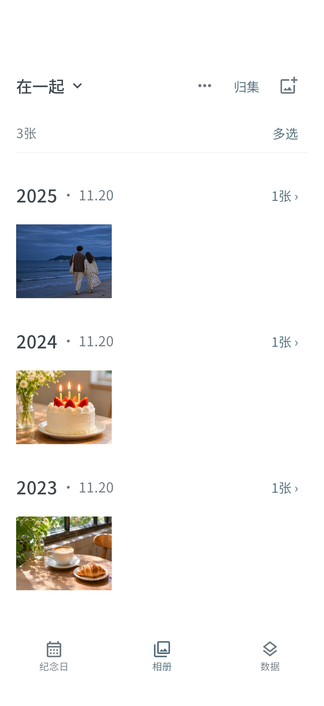
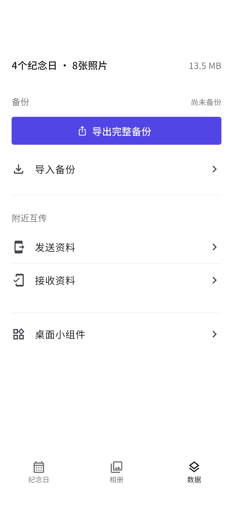

# 拾日 · Shiri

把重要的日子和那一天的照片，留在自己的手机里。

拾日是一款本地优先的纪念日与照片应用，使用 Flutter 构建，支持 **iOS 16+、Android 8+** 和两端桌面小组件。无需账号，照片与纪念日保存在设备上，不依赖云端服务。

[下载与发布说明](https://github.com/shawncai/anniversary/releases) · [开发说明](docs/IMPLEMENTATION.md) · [验收记录](docs/QA.md) · [问题反馈](https://github.com/shawncai/anniversary/issues)

## 界面预览

| 纪念日 | 按年份整理的相册 | 备份与互传 |
| :---: | :---: | :---: |
|  |  |  |

以上为现有 iOS 模拟器验收流程的实际截图，使用独立测试资料库。截图中的照片、日期和数量仅用于演示；正式应用首次打开为空库，不内置示例相册。首页截图保留了操作后的提醒提示。

## 可以做什么

- **记住重要日期**：显示累计天数、下次周年倒计时，支持每年重复或单次事项；闰日与跨年日期窗口均有对应处理。
- **把照片归到纪念日**：新建纪念日后自动尝试一次归集，之后点击“归集”才再次读取已授权照片；支持手动补选、按年份浏览与内容去重。
- **管理相册和封面**：多选照片、加入其他纪念日、移出当前纪念日；封面支持固定、轮播、每天定时或按间隔换图，可使用全部照片、指定年份或自选组。移出关联不会删除原图。
- **设置提醒**：新建事项默认每年重复、当天 09:00 提醒。授权后写入本机系统日历；无可用本机日历或未授权时，保留应用内提醒并给出提示。
- **备份与换机**：导出包含原图的 `.shiri` 完整备份，导入前预览新增、重复和冲突内容，默认保留本机数据；同一 Wi-Fi 或热点下可进行加密互传，蓝牙辅助发现。
- **添加桌面小组件**：使用 WidgetKit 和 Android App Widget 展示封面、倒计时与累计天数，点击打开对应纪念日。

首页只展示照片与核心天数；添加、编辑、封面和照片管理集中在“相册”。字体离线打包 Adobe 思源黑体，包含 Light、Regular、Medium、Bold 四种字重。

## 下载与开始使用

到 [Releases](https://github.com/shawncai/anniversary/releases) 下载附件，并查看该版本的验证范围。

| 附件 | 用途 |
| --- | --- |
| `shiri-debug.apk` | Android 开发签名调试包，供安装体验和开发验收，非商店发行包。 |
| `shiri-ios-unsigned.zip` | iOS 未签名应用构建，供开发者使用；不能直接安装到 iPhone，真机安装需配置自己的开发团队与 App Group 签名。 |
| `SHA256SUMS` | 安装包校验摘要。 |

1. 打开应用，进入“相册”，添加纪念日并填写首次日期、照片归集范围。
2. 按需授予照片权限，归集已有照片，或通过系统选取器手动添加。
3. 在相册的“⋯”中编辑纪念日、设置封面和日历提醒。
4. 在“数据”页导出备份，或让两台手机进入发送／接收流程，核对双方六位配对码后传输。
5. 从系统桌面的小组件面板添加拾日小组件。

## 数据与权限

纪念日、照片副本和缩略图保存在应用私有目录，应用不使用账号、广告或统计 SDK。照片导入会复制原图到应用目录；应用数据已排除系统云备份，请自行导出并妥善保存备份。

| 权限 | 使用场景 |
| --- | --- |
| 照片访问 | 按日期归集已授权照片，或通过系统选取器手动补选。 |
| 日历 | 将提醒写入本机日历，实际后台通知由系统日历负责。 |
| 蓝牙、附近设备与局域网（依平台而定） | 发现附近设备并在本地网络中互传；也支持手动填写接收地址。 |

互传使用系统 P-256 ECDH、HKDF-SHA256 与 AES-256-GCM，双方确认配对码后才能发送照片。导出的 `.shiri` 备份本身**没有密码加密**，包含照片原图及纪念日信息，请存放在可信位置，不要提交到仓库或公开分享。

## 本地开发

已验证工具链为 **Flutter 3.32.6 / Dart 3.8.1**。项目使用 Flutter 自带的 Dart 包管理，依赖锁定在 `pubspec.lock`；无需 Node.js、npm 或 yarn。依赖用途与审查记录见 [DEPENDENCIES](docs/DEPENDENCIES.md)。

- Android：安装 Android SDK、兼容的 JDK，以及构建配置指定的 NDK `26.3.11579264`。
- iOS：需要 macOS、完整 Xcode、iOS 平台组件与 CocoaPods；最低系统版本为 iOS 16。

```sh
git clone https://github.com/shawncai/anniversary.git
cd anniversary
flutter --version
flutter doctor -v
flutter pub get --enforce-lockfile
flutter analyze --no-pub
flutter test --no-pub --concurrency=1 --reporter expanded
flutter devices
flutter run -d <设备ID>
```

依赖已缓存时可用 `flutter pub get --offline --enforce-lockfile`。不运行自动依赖升级，不把本地 SDK 路径、签名材料或环境凭据写进源码。

### 构建

```sh
# Android 开发安装包
flutter build apk --debug

# iOS 无签名构建，仅适用于 macOS
flutter build ios --debug --no-codesign
```

Android 默认产物位于 `build/app/outputs/flutter-apk/app-debug.apk`。iOS 签名与外置磁盘构建说明见 [IMPLEMENTATION](docs/IMPLEMENTATION.md)；真机安装见 [iPhone 安装清单](docs/IPHONE_INSTALL_CHECKLIST.md)。Android release 不复用 debug 签名，发行签名需在自己的构建环境中配置。

在 macOS 外置磁盘上生成文件后执行 `dot_clean ./`，避免 AppleDouble 元数据进入构建。`.gitignore` 已排除构建缓存、设备日志、个人备份、环境配置与常见签名文件；安装包通过 release 附件分发。

### 目录

```text
lib/core/          日期、资料库、备份与传输逻辑
lib/ui/            页面、主题与应用控制器
lib/platform/      Flutter 与原生平台桥接
android/           Android 原生能力与桌面小组件
ios/               iOS 原生能力与 WidgetKit 扩展
assets/            离线字体与字体许可证
test/              单元、组件测试与测试夹具
integration_test/  设备流程测试
test_driver/       集成测试驱动
scripts/           原生工程配置辅助脚本
docs/              平台约定、验收、截图与发布记录
design/            设计参考与样式变量
```

## 验证范围与已知限制

日期、本地存储、备份校验、配对传输和界面行为有自动化测试；历史模拟器与原生验收记录见 [QA](docs/QA.md)，本次验证见 [发布清单](docs/RELEASE_CHECKLIST.md)。

- 两台真实手机之间的 BLE 发现、局域网权限、长时间大相册传输、网络切换和后台恢复仍需实机验收。
- 小组件刷新由系统调度，不保证秒级刷新或与应用内轮播同步。
- 系统日历通知需要日历访问权限及系统通知设置；无本机日历源时不写入云端日历。
- 云端原图在本地不可读时会报告不可用，不静默下载。应用卸载可能移除私有资料，请先导出备份。
- 目前提供的是开发验收构建，不代表已经完成应用商店上架或全部真机兼容性验证。

## 更多资料

- [实现与运行说明](docs/IMPLEMENTATION.md)
- [Flutter / 原生平台约定](docs/PLATFORM_CONTRACT.md)
- [设计系统](DESIGN.md)
- [依赖与字体来源](docs/DEPENDENCIES.md)
- [构建验收记录](docs/QA.md)

思源黑体遵循 [SIL Open Font License 1.1](assets/licenses/source_han_sans_OFL.txt)，来源和摘要见 [字体清单](assets/font_manifest.json)。项目源码暂未指定开源许可证，字体许可证仅适用于对应字体文件。
